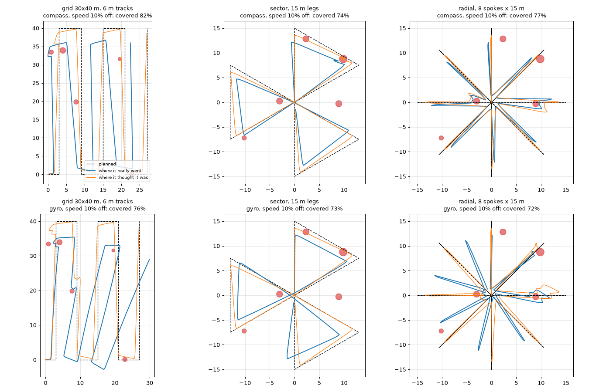

# integration: putting the robot together

```
              ROBOT                                                 BASE
 ┌─────────────────────────────────────────────┐
 │ Logitech camera ─USB─┐   BNO055 IMU ─I2C─┐  │
 │               Raspberry Pi 5: pi/main.py ─USB─ Heltec ~~LoRa~~ Heltec ─USB─ Laptop: piku/.../base.py
 │                      │                      │
 │            USB serial│ DRIVE / STATUS        │
 │                      ▼                      │
 │   ESP32: firmware/main.cpp ── L298N ── motors│
 │          + IR distance sensor               │
 └─────────────────────────────────────────────┘
```

| Part | Runs on | Code | Owner |
|---|---|---|---|
| Robot main program | Raspberry Pi | `integration/pi/main.py` | |
| Radio messages (Meshtastic) | Pi + laptop | `piku/meshtastic-testing/` | Piku |
| Person / AprilTag detection | Pi | `integration/pi/vision.py` (same settings as `adi/person.py`, `adi/main.py`) | Adi |
| Motor control + safety stops | ESP32 | `integration/firmware/main.cpp`, `alan/control/` | Alan |
| Search patterns, position estimate | Pi | `integration/pi/planner.py`, `estimator.py`, `navigator.py` | |
| Pi ↔ ESP32 message format | | `shared/serial_protocol.md` | |

## What the robot does

`pi/main.py` loops 20 times a second. Detection runs in a background thread, so a slow camera
or a slow YOLO never delays the radio or the motor commands.

| State | Behavior | Leaves on |
|---|---|---|
| `IDLE` | Motors off. Waiting. | `SCAN` or `RESUME` from the base |
| `EXPLORING` | Follows the search pattern. Detours around obstacles the ESP32 reports. | target confirmed, end of pattern, `STOP`, `HOME` |
| `FOUND` | Motors off. Sends a `DETECTION` to the base (Piku's code resends it until the base confirms). Prints the estimated position. | `RESUME` / `SCAN` |
| `SEARCH_DONE` | Reached the end of the pattern. Motors off. | `SCAN` (repeat) / `HOME` |
| `RETURNING` | Drives back to the start point (0, 0). | arrives, then `STOPPED` |
| `STOPPED` | Motors off. | `RESUME` / `SCAN` / `HOME` |

`SCAN` starts the pattern from the beginning. `RESUME` continues it from where it stopped.
The heartbeat now carries the estimated heading.

A target counts as found after 5 frames in a row (`--confirm-frames`). The state goes out in
every heartbeat, so `status` on the base shows it.

**Safety is on the ESP32, not the Pi.** The ESP32 stops the motors if the Pi stops sending
commands for 300 ms (crash, frozen program, unplugged cable). It also refuses to drive forward
when the distance sensor sees something close. See `shared/serial_protocol.md`.

## Search patterns

Coordinates are metres from the start point: x = east, y = north. Put the robot down next to
the base, facing any direction, and that spot becomes (0, 0). `--pattern-heading` rotates the
pattern (compass degrees for the first track, leg, or spoke).

| Pattern | Use when | Options |
|---|---|---|
| `grid` | Searching a whole area evenly. Back-and-forth parallel tracks over a box. | `--width` (across the tracks), `--length`, `--spacing`, `--side right/left`, `--datum X Y` = start corner |
| `sector` | The person's last known position is good. The IAMSAR "VS" pattern: legs of `--radius`, 120° turns, three triangles that all pass through the datum. Coverage is densest at the datum. | `--radius`, `--datum X Y` = last known position |
| `radial` | Quick look in every direction from a point. Out and back along `--spokes` evenly spaced lines. | `--radius`, `--spokes`, `--datum X Y` = centre |

**`--spacing`** is the distance between grid tracks. Set it to about **twice the distance at
which the camera reliably spots a person**, so neighbouring tracks' views overlap. Measure that
distance outdoors with a teammate before choosing it. The default is 6 m, which assumes about 3 m.

The robot detours around obstacles: it turns away for about 1 s, drives straight for 2 s, then
heads for the waypoint again. If it gets blocked 4 times on the way to one waypoint, it skips
that waypoint so one blocked spot can't stall the whole search.

## Position without GPS

There's no GPS, and the motors have no encoders, so the robot estimates its position by
**dead reckoning**: heading from the IMU, and distance from "calibrated speed × time driving".
`estimator.py` is a small Kalman filter that:

- predicts the position and heading from the motor speeds the ESP32 actually applied (from
  `STATUS`, so safety stops are accounted for)
- corrects the heading from the IMU every loop, weighting it against the motor-based guess by
  how noisy each one is
- keeps track of how uncertain the position is, so `FOUND` reports something like "x 12.3 m,
  y 30.1 m from the start (±2.4 m)"

**What a Kalman filter can and can't do here.** It reduces *random* noise by combining sources
of information. The biggest error without GPS isn't random, though: if the calibrated speed is
10% too high, every metre is 10% short, and nothing on the robot measures that. The filter
can't remove that error, only report it, so its position uncertainty grows with distance from
the start. **Calibration matters more than the filter.**

### Simulation results

`python pi/sim_search.py --plot docs/search_sim.png` drives the patterns in a simulated field
with 5 random obstacles, using the same navigation code as the robot. The simulated robot is
deliberately imperfect:

- the real speed is 10% below the calibrated one
- the wheels slip at random
- turns are ±10% off
- the compass has a 3° bias
- the gyro drifts

Averages over 8 runs each:

| Pattern | Setup | Worst position error | Area covered (camera sees 3 m either side) |
|---|---|---|---|
| grid 30×40 m, 6 m tracks (best possible: 100%) | BNO055 compass, speed 10% off | 5.3 m | 81% |
| | BNO055 compass, speed 3% off | 2.8 m | 87% |
| | MPU6050 gyro, speed 10% off | 9.8 m | 76% |
| | no IMU | 6.0 m | 80% |
| sector, 15 m legs (best possible: 77%) | BNO055 compass, speed 10% off | 1.7 m | 74% |
| | MPU6050 gyro | 3.2 m | 74% |
| radial, 8 × 15 m (best possible: 78%) | BNO055 compass, speed 10% off | 1.6 m | 76% |
| | MPU6050 gyro | 4.6 m | 72% |

- **Sector and radial patterns stay accurate without GPS**, within about 2 m. Every leg comes
  back through the centre, so a speed error on the way out mostly cancels on the way back.
  Coverage is within a few percent of the best these patterns can do.
- **The grid drifts most.** It's one long path that never returns to the start, so errors add
  up: a 10% speed error put it 5 m off by the end. Calibrating the speed to 3% halved that.
- **Get a BNO055 rather than an MPU6050.** A gyro-only heading drifts, and on the grid that
  roughly doubled the error. The BNO055 has a magnetometer, so its heading doesn't drift.
- "No IMU" scores close to the compass on the grid only because the simulated turns are
  unbiased. Real turns on grass or uneven ground aren't, so don't rely on that.



### Ways to correct the position without GPS (not implemented yet)

- **An AprilTag at the base.** The robot already detects AprilTags. If it knows the tag sits at
  (0, 0), seeing it gives an exact fix, and `estimator.reset_position()` already exists for
  this. Sector and radial patterns pass the centre every few legs, so they'd get a fix that often.
- **Keep grid legs short.** Several small grids that each start from a known point drift less
  than one large one.

## 1. Flash the ESP32

Install PlatformIO (`pip install platformio`, or the VS Code extension), plug in the ESP32,
and from the repo root:

```sh
pio run -e bot1 -t upload       # regular ESP32 (esp32dev)
pio run -e s3test -t upload     # the temporary ESP32-S3 dev board
```

Test it by hand before involving the Pi:

```sh
pio device monitor -b 115200 --echo --eol LF
```

You should see `READY`, then a `STATUS ...` line every 100 ms. Type `DRIVE 150 150` with
the wheels off the ground. They should spin for 0.3 s and stop with `TIMEOUT`. That stop
is the safety timeout working.

## 2. Set up the Raspberry Pi

1. Install **Raspberry Pi OS (64-bit)** with Raspberry Pi Imager. In its settings, enable SSH
   and set up Wi-Fi so you can work on the Pi from your laptop (only needed for setup).
2. Copy the repo over (`git clone`, or `scp -r`).
3. Install the Python packages in a virtual environment. Pi OS refuses `pip install` without one.
   ```sh
   cd hackumass2026/integration/pi
   python3 -m venv ~/sar
   source ~/sar/bin/activate
   pip install -r requirements.txt     # ultralytics pulls in PyTorch; this takes a while
   sudo usermod -aG dialout $USER      # serial port access; log out and back in after
   ```
4. Enable I²C for the IMU: `sudo raspi-config` → Interface Options → I2C, then reboot.
   Check the IMU is seen with `i2cdetect -y 1`: a BNO055 shows up at `28`, an MPU6050 at `68`.
5. Prepare the Heltec as in `piku/meshtastic-testing/README.md` (region, channel URL, and
   `SECRET` in `common.py`, which must match the base).

### Wire and mount the IMU

| IMU pin | Pi 5 pin |
|---|---|
| VIN / VCC | 3.3 V (pin 1) |
| GND | GND (pin 6) |
| SDA | GPIO 2 / SDA (pin 3) |
| SCL | GPIO 3 / SCL (pin 5) |

- Mount it **flat**, with its marked forward direction facing the robot's front. Check the
  direction: run `main.py` with `--sim-radio` and turn the robot by hand. The printed heading
  should go **up** when you turn it clockwise (seen from above).
- Keep the BNO055 **at least 10–15 cm from the motors and battery wires**. The motors' magnets
  and current bend the compass reading. A short mast works well.
- The BNO055 calibrates itself as it moves. `main.py` prints its calibration at startup
  (`3` = calibrated for each part). Before a search, turn the robot slowly through a full
  circle and tilt it a little, until the magnetometer value reaches 3.
- `--declination` turns magnetic north into true north. The default is -14° for Massachusetts.
  Look up your location's value if you're elsewhere, or use 0 if you only need directions
  relative to the start.
- If you see repeated I²C errors with the BNO055 (it holds the clock line, which some I²C
  controllers dislike), slow the bus down: add `dtparam=i2c_arm_baudrate=50000` to
  `/boot/firmware/config.txt` and reboot.

### Calibrate speed and turn rate

Do this **on the surface you'll search**. Grass is much slower than pavement.

```sh
python calibrate.py --motor-port <esp32 port> forward --seconds 10   # measure the distance with a tape
python calibrate.py --motor-port <esp32 port> --imu bno055 spin --seconds 4   # measures the turn itself
```

`--speed-mps` is the distance in metres divided by 10. `--turn-rate` is printed by the spin
test. Pass both to `main.py`. Do the forward test 2–3 times and average, because the speed
error sets the position error (see the simulation results above).

### Find the serial ports

The Pi has **two USB serial devices**: the Heltec and the ESP32. Both often use the same
CP210x USB chip, so Meshtastic's auto-detect can grab the ESP32. Always give both ports, using
the stable names under `/dev/serial/by-id/` (`/dev/ttyUSB0` and `/dev/ttyUSB1` can swap on reboot):

```sh
ls -l /dev/serial/by-id/
# unplug one board, run it again, and see which entry disappeared
```

## 3. Run

On the laptop (Heltec plugged in): `python piku/meshtastic-testing/base.py --port <heltec port>`

On the Pi:

```sh
source ~/sar/bin/activate
cd hackumass2026/integration/pi
python main.py --id 1 \
  --radio-port /dev/serial/by-id/usb-Silicon_Labs_CP2102...-port0 \
  --motor-port /dev/serial/by-id/usb-Silicon_Labs_CP2102...-port0 \
  --imu bno055 --speed-mps 0.45 --turn-rate 85 \
  --pattern grid --width 30 --length 40 --spacing 6
```

It prints the plan ("grid search: 10 waypoints, 227 m, about 8 min"), then every 5 s the
estimated position, heading, uncertainty, and distance to the next waypoint.

Then on the base, type `scan 1` to start the search, `stop 1` to stop, and `status` for the list.

| Option | Default | Notes |
|---|---|---|
| `--id N` | 1 | unique per robot; 0 is the base |
| `--radio-port` | auto-detect | Heltec port. Give it (see above). |
| `--motor-port` | (required) | ESP32 port |
| `--imu` | `bno055` | `bno055`, `mpu6050`, or `none` |
| `--start-heading` | 0 | compass heading the robot faces at start. Needed with `mpu6050`/`none`, which can't tell north. |
| `--declination` | -14 | BNO055 only, see above |
| `--speed-mps` | 0.5 | forward speed at cruise, **measure it** |
| `--turn-rate` | 90 | spin rate in deg/s, **measure it** |
| `--pattern` | `grid` | `grid`, `sector`, `radial`, plus their options in "Search patterns" |
| `--arrive-radius` | 1.5 | a waypoint counts as reached within this many metres |
| `--vision` | `person` | `person` (YOLOv8n), `apriltag`, or `none` |
| `--tag-id` | 0 | AprilTag ID for `--vision apriltag` |
| `--camera` | 0 | camera index, or a video file |
| `--min-confidence` | 0.6 | person detector threshold |
| `--confirm-frames` | 5 | frames in a row needed for a detection |
| `--autostart` | off | start the search without waiting for `scan` |
| `--no-obstacle-stop` | off | use when no distance sensor is wired up. An unconnected analog pin reads random values that can block forward driving. |
| `--sim-radio` | | Piku's fake radio, instead of `--radio-port` |
| `--sim` | | simulated motors and IMU, instead of `--motor-port`. Prints the true simulated position next to the estimate. |

YOLO downloads `yolov8n.pt` (6 MB) on its first run, so do one run with internet before
heading out.

### Testing without hardware

On one computer, in two terminals:

```sh
python piku/meshtastic-testing/base.py --sim
python integration/pi/main.py --sim-radio --sim --pattern sector --radius 5 --vision person --camera 0
```

Type `scan 1` in the base window and step in front of the camera.

## Tested so far

All on a laptop. **Not yet on a real Pi, ESP32, or Heltec.**

- Firmware builds for `bot1` and `s3test` (PlatformIO).
- Firmware logic, run on the laptop against a fake serial port and motors:
  - `DRIVE` / `STOP` / `PING` / `OBSTACLE` work, and bad commands get `ERR`.
  - The 300 ms timeout stops the motors.
  - The obstacle stop blocks forward driving, but still allows turning and reversing.
- Full chain: `base.py --sim` ↔ `main.py` ↔ that emulated ESP32, with a test video:
  - `scan 1` starts the robot.
  - YOLO finds the person, and the robot stops and reports it. The base shows the alert.
  - `resume 1` and `stop 1` work.
  - An obstacle makes the robot turn.
  - Killing `main.py` with `kill -9` stops the motors within 300 ms.
- Search patterns: `sim_search.py`, 8 runs per pattern and setup. All runs finished their
  pattern, including detours around 5 obstacles. Results are in "Simulation results" above.
- Real time with `base.py --sim` ↔ `main.py --sim`, on a 4 m sector pattern:
  - `scan 1` started the pattern, and YOLO found the person in the test video.
  - The robot stopped and reported the person's position.
  - `resume 1` continued the pattern.
  - `home 1` drove it back to the start.
- Not tested: the BNO055/MPU6050 drivers (no IMU here) and `calibrate.py` (no robot).

## Not done yet

- **Real hardware.** Nothing above has run on the Pi, ESP32, Heltec, or an IMU yet.
- **Position in the detection message.** The robot prints where it found the person, but
  Piku's `DETECTION` message only carries the confidence and the camera box, so the base never
  sees the position. Ask Piku to add `x`/`y` fields to `DETECTION` (about 15 bytes, well inside
  the size limit), and `report_found()` in `main.py` can fill them in.
- **Position corrections** from an AprilTag at the base, see above.
- **Battery.** The heartbeat always reports 100%. Nothing measures it yet.
- **Choosing the pattern from the base.** The pattern is set on the Pi's command line. Piku's
  commands are only STOP / RESUME / HOME / SCAN.
- **Dashboard.** `dat/ui` isn't connected. `base.py` is the base station for now.
- **Speed on a Pi.** YOLOv8n at 320×320 hasn't been timed on a Pi 5 yet. If it's too slow, try
  `--vision apriltag`, which is much lighter.
- `alan/search/planner.cpp` is still empty. The planner lives on the Pi in Python, so it isn't needed.
